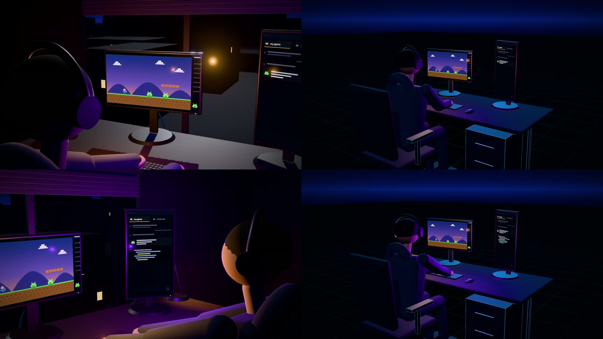
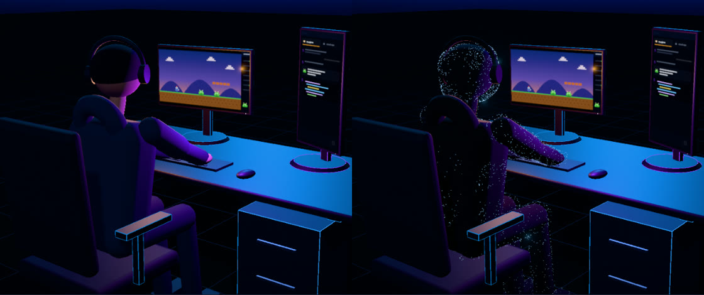
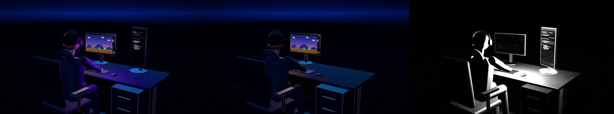

# Style Lab V2: fewer objects, a still camera, editable shots

**Less movement. Fewer objects. Better execution.**

This document is the working standard for 3D shots from now on, and the manual for the shot editor that makes them editable. The audit of the six cinematic experiments that led here is in [`docs/style-lab-v2/AUDIT.md`](style-lab-v2/AUDIT.md).

What changed in this pass, in one paragraph: the Style Lab got a small shot editor (Style Lab → scene → **Edit shot**). A 3D scene can now declare its objects, lights, camera, stage look and timing cues as a typed configuration with code defaults; a sparse JSON file next to the scene (`shot.json`) overrides only what someone changed. The editor edits a draft of that file with a live preview, saves it back into the repo, and Remotion renders the same file. X01 (*John at his computer*) is the proof of concept: its original version is still the code default (room, city, moving camera; only the figure's proportions were corrected in code), and its approved `shot.json` turns it into a legacy-style shot without further code. No other scene was redesigned.



---

## 1. The visual language: the Legacy Experiments

The baseline is the original ten samples in `src/scenes/style-lab/` and their tokens in `src/styles/cyber.ts`. The cinematic experiments drifted away from them (brown rooms, sodium lamps, a green "safe" colour, reduced bloom); V2 goes back.

| Trait | Token / helper | Rule |
| --- | --- | --- |
| The void | `cyber.color.void #04050A`, `abyss #070A14` | The frame is a deep blue-black, never a lit room by default. |
| Horizon line | `SkyDome` (`components/cyber/three/Environment.tsx`), `HorizonHaze` (shot object) | A thin cold line where floor meets void. It is the constant of the look. |
| Obsidian floor | `MirrorFloor`, `ObsidianFloor` (`components/cinematic/three/LegacyStage.tsx`) | Unlit near-black floor, a faint hairline grid that fades out, contact shadows only. Lights never wash it. |
| Matter vs. light | `structureProps`, `hdr()` | Objects are dark matte matter. Light comes from a few sources and a few luminous accents. Neon is a signal, not a material. |
| Luminous edges | shot object `edges` | Clean hairlines on hard edges of the objects that matter, at `dim 0.55` to `base 1.5`. Never on everything. |
| Three colours | `tone.system` blue `#2E9BFF`, `tone.mind` violet `#8B3DFF`, `tone.threat` red `#FF2A3C` | Blue = systems, violet = AI, red = threat, used sparingly. No extra hues for decoration. |
| Glow budget | `cyber.emissive` dim 0.55 / base 1.5 / strong 2.6 / hot 4.5; bloom 0.85 / 0.72 / 0.92 | Only colours above the bloom threshold glow. More than ~3 strongly glowing things in a frame: dim something. |
| Fog | `cyber.fog` `#05060D`, 0.018 | Distance falls into the void. |

The legacy samples that show this best: **05-scan** (one frame carries the idea: edge-lit blocks on glass, a red core below), **06-cloud** (a remote place as a few edge-lit cabinets and one curve), **01-hero / 02-agent** (the violet core as "the AI"). Their own weaknesses are listed in the audit (01 and 02 also travel too much).

## 2. Camera rules

**The camera stays still.** A shot is composed once; the objects inside it move.

1. One fixed camera per shot, across all of its beats. New shots are created with `camera.locked = true`.
2. No orbiting, sweeping, fly-throughs or "travel to connect two places".
3. Allowed only when it clarifies space or reveals what cannot otherwise be shown: a subtle push-in, a small reframe, a deliberate change of scale. Each one is authored on purpose as a camera move bound to a beat, and the shot is unlocked for it.
4. Two different compositions are two shots joined by a cut, not one shot with a camera journey between them.
5. Default lens: fov 30–36 (legacy 34), three-quarter or frontal. Keep the subject's silhouette clear of the frame edge and of other objects.
6. The editor's free camera (orbit / pan / zoom) is for inspecting geometry only. It never changes the shot camera unless you press **Use inspection view as shot camera**.

In the editor the viewport badge says which state the shot is in (**Shot camera · locked** or **moves on beats**), and the beat strip marks every beat in which the camera moves.

## 3. Lighting conventions

Every editable shot has the same **rig**: `key`, `fill`, `rim`, `ambient`, `sky` (`src/shot/presets.ts`, `rigLights()`). Scenes add **environment** lights (window, room bounce) and **practicals** (screen glows, a lamp) that belong to objects.

Presets (Stage → Lighting presets):

| Preset | What it does |
| --- | --- |
| **Legacy neon** | The original samples' light: a cold blue rim draws silhouettes (2.6), a faint blue-violet ambient (0.32) and sky bounce, a soft shadowing key (0.9), almost no fill. Bloom 0.85 / 0.72 / 0.92, fog 0.018. Environment lights off, practicals kept. |
| **Legacy night** | Same palette, darker; the screens carry the scene. |
| **Practicals only** | Rig off, to check what the scene's own sources do. |

Conventions:

- Screens and other practicals are the warm or violet accents; the rig stays cool.
- Rim light from behind the subject, relative to the camera. Because the floor is unlit, a rim never turns it into a blue plane (the first PoC iterations did exactly that with a glossy lit floor; see §9).
- Glossy surfaces facing the camera pick up the rim as glare (a desk top at roughness 0.45 became the brightest thing in the frame). Keep large surfaces matte (roughness ≥ 0.8).
- Lights are never mounted or unmounted mid-shot (three.js recompiles every shader when the number of lights changes; that was the stutter fixed in the previous pass). A disabled light stays mounted at intensity 0.

## 4. Object quality standards

**Minimise object count. Maximise quality per object.** Every object must do one of three jobs, and the shot definition records which (`purpose`, shown in the inspector):

1. **Explain** something (the game screen, the agent screen).
2. **Establish necessary context** (a desk, a chair: he is working).
3. **Support the composition** without drawing the eye.

If it does none of these it is hidden, then deleted from the scene when the shot is redesigned.

Quality bar for anything that stays in frame:

- No intersections (chair vs. body, hands in the desk), no floating, no sinking.
- Believable proportions (arms: upper ~0.30 m, forearm ~0.28 m; seated thighs resting on the seat).
- No stacked-primitive stand-ins presented as finished assets (the cone plant, the box city). If a complex object cannot be modelled convincingly in scope, simplify the composition or leave it out.
- Matte, dark materials; selective luminous accents. No glossy plastic look.
- Recognisable actions matter more than facial detail. Figures stay faceless.

### The developer: options A and B

Both exist as variants of the `developer` object (inspector → Model):

- **A · Stylised figure (matte)**: the existing figure with corrected proportions behind a `refined` flag (two-bone IK arms with real lengths, thighs resting on the seat, the hood clear of the chair back, hands that stay on the keyboard when the figure is moved). Used in the approved X01.
- **B · Light-dot hologram**: the same body as a black silhouette covered in about 6,200 light dots placed on the pose every frame (deterministic seed). Reads as a person from any angle; it is noisier than A at this distance and needs more density/size tuning before it is a finished look.



Neither is final character art. The figure is still built from capsules and spheres; it is now proportionate and no longer intersects, but a properly modelled character (or a GLB asset, see §8) is the next step for the detailed X01 redesign. X02 and X03 still use the original construction (the `refined` flag is off for them) and are unchanged.

## 5. Simplicity and clarity

- **Visual shorthand, not literal depiction.** Show the meaningful event, not every noun in the narration. "The instruction went to the wrong project" is a workstation with two repositories and an action landing in the other one, not a city and a data hall.
- One clear subject per shot; the narration completes the picture.
- Minimal on-screen text. If a frame needs a label to be understood, the staging is unclear.
- Before building a shot, write down: what the viewer should understand; the minimum objects; the best static camera; which objects move; what changes per beat; what stays constant; which light reveals the important elements.
- Sometimes one precise action in a still frame is better than thirty seconds of movement.

---

## 6. The shot editor

Open it from the gallery (**Edit shot** on an editable tile) or from the viewer (**Edit shot** in the top bar), or go to `/style-lab/<slug>/edit`. All six 3D scenes open in it: X01 with objects, lights, look and camera; X02–X06 with their camera and timing (their objects stay code until they are redesigned). The editor supports the direction; it is not the goal. The look itself comes from the Legacy Experiments (see [`docs/style-lab-v2/LEGACY_REFERENCE.md`](style-lab-v2/LEGACY_REFERENCE.md)).

```
┌──────────────────────────────────────────────────────────────────────────────────────┐
│ Style Lab / X01 John at his computer / Edit shot   [Draft · 75 changes]  Undo Redo   │
│                                   Free camera  Helpers  Revert  Code defaults        │
│                                   Import  Export JSON  Save to repo                  │
├────────────┬──────────────────────────────────────────────┬──────────────────────────┤
│ Hierarchy  │  the real composition (Remotion Player)      │ Inspector                │
│  Stage     │  badge: Shot camera · locked                 │  object / light /        │
│  Room      │                                              │  camera / stage /        │
│  Workstat. │                                              │  beat / motion           │
│  People    ├──────────────────────────────────────────────┤  or: changes vs code    │
│  Lights    │  beat strip: beats, holds, cues, playhead     │                          │
│  Shot      │  frame 558 / 851 · beat 3 · keys              │                          │
└────────────┴──────────────────────────────────────────────┴──────────────────────────┘
```

| Area | What it does |
| --- | --- |
| **Hierarchy** | Objects by group, lights (rig / environment / practical), the camera (lock icon) and the stage look. The eye hides/shows an object, the bulb switches a light, the lock locks the camera. An amber dot marks anything the draft changes. |
| **Viewport** | The actual composition in a Remotion Player, with the same presenter keys as everywhere: → next beat, ← previous checkpoint, R replay, F fullscreen, H HUD, Space play. Click an object to select it. Helpers (selection box, light markers) only exist in the editor. |
| **View: Shot / Fly / Free** | *Shot* looks through the shot camera (what renders). *Fly* looks through it and lets you drag it: orbit (drag), pan (right-drag or Shift-drag), dolly (wheel), lens (Alt+wheel); the drag edits the camera keyframe at the playhead, creating one if needed. *Free* (`I`) is an inspection camera that never changes the shot; it shows the shot camera's frustum and its keyed path, and K / C key the shot camera to the view you found. |
| **Timeline** | Laid out like a video editor: a ruler (drag anywhere to scrub to any frame), the beats (hatched = export-only hold), the **camera track** (clips are shots, a cut starts a new clip; diamonds are keyframes, red = cut; drag to retime, click to select, double-click to jump), the cues, and **review notes** (flags). Play/pause, timecode, zoom. |
| **Inspector** | Object: visibility, opacity, model variant, position / rotation / scale around the pivot, material slots (colour, emissive, emissive ×, roughness, metalness), luminous edges, transform motions. Light: on/off, intensity, colour, ground colour, position, target, shadows, cone, range. Camera: lock, projection, position, target, fov / ortho height, roll, per-beat moves. Stage: presets, bloom, exposure, fog, background, shadows, grade. Beat: start / checkpoint / end frames, duration, export hold, cues and motions inside it. Motion: beat, start / end offsets, easing, enabled, and for transform motions the target position / rotation / scale / opacity / visibility. With nothing selected: every change the draft makes, each with its own reset. |
| **Fields** | Type a value, arrow keys (Shift ×10, Alt ÷10), or drag the label to scrub. ↺ resets that one property to its code value. |
| **Undo / Redo** | Ctrl+Z / Ctrl+Shift+Z (Ctrl+Y). Rapid changes to one field coalesce into one step. |

### Architecture

```
scene folder (code)                     src/shot/ (engine)                       Style Lab
───────────────────                     ──────────────────                       ─────────
shot.ts   defineShot({objects,          types.ts    schema + patch types
          lights, camera, stage,        resolve.ts  code defaults <- patch,       editor/ShotEditor.tsx
          motions, approved})                       motions, camera at frame      ├ Hierarchy.tsx
shot.json approved patch  ─────────►    patch.ts    set/unset paths, validate,    ├ Inspector.tsx + fields.tsx
JohnScene.tsx  <ShotObject id>                      stable JSON                   ├ BeatStrip.tsx
               useLook(slot)            runtime.tsx shotComposition, ShotObject,   └ useShotDraft.ts (draft,
               useMotion(cue)                       useLook, useMotion,              undo, localStorage)
               useShotRig/Stage                     useShotRig, ShotLights …
index.tsx  Sample = shotComposition()   presets.ts  rig + lighting presets        vite.config.ts: POST /__shot/save
                                        EditorOverlay.tsx  editor-only helpers     (dev server only)
```

- **One source of truth.** `shotComposition(def, baseEpisode)` is the component the gallery plays, the editor previews and Remotion renders. Its `shot` input prop replaces the approved patch; without it the approved `shot.json` is used. The editor passes the draft as that prop, so the preview is exactly what `--shot=draft.json` renders.
- **Determinism.** Everything is a pure function of the frame and the patch. Motions use the engine's beat clocks (clamped progress), so checkpoints still hold indefinitely. Luminous edges are synced after every render; the hologram's dots are a fixed-seed sample.
- **Editor isolation.** The editor's handle (`ShotEditorContext`) only exists around the editor's Player. Remotion renders never have one, so selection boxes, light markers and the free camera cannot reach an MP4.
- **Timing edits.** Beat durations/holds from the patch build the episode (`applyShotBeats`), so the presenter's timeline, the Remotion composition length (`calculateMetadata` in `src/remotion/Root.tsx`) and the gallery all follow the same numbers.

### The editable property schema

`src/shot/types.ts` is the authority. A patch (and `shot.json`) looks like this; every key is optional and only changed values appear:

```jsonc
{
  "version": 1,
  "shot": "cine-01-john",
  "note": "free text for reviewers",
  "objects": {
    "<objectId>": {
      "visible": true, "opacity": 1, "variant": "figure",
      "position": [0, 0, 0.74], "rotation": [0, 15, 0], "scale": 1,   // metres, degrees, around the pivot
      "materials": {"<slot>": {"color": "#0C1122", "emissive": "#000000", "emissiveIntensity": 1, "roughness": 0.85, "metalness": 0.1}},
      "edges": {"enabled": true, "color": "#2E9BFF", "intensity": 1.3, "threshold": 35}
    }
  },
  "lights": {
    "<lightId>": {"enabled": true, "color": "#2E9BFF", "groundColor": "#04050A", "intensity": 2.6,
                  "position": [-3, 4.2, -5], "target": [0, 1, 0], "castShadow": false, "angle": 40, "penumbra": 0.5, "distance": 0}
  },
  "camera": {
    "locked": true, "projection": "perspective", "position": [1.85, 1.62, 2.45], "target": [-0.08, 0.92, -0.12],
    "fov": 32, "orthoHeight": 4, "roll": 0,
    "moves": {"<beatId>": {"enabled": true, "position": [...], "target": [...], "fov": 30, "from": 0, "until": 2.2, "easing": "camera"}}
  },
  "stage": {"exposure": 1, "bloom": {"enabled": true, "strength": 0.85, "radius": 0.72, "threshold": 0.92},
            "fog": 0.018, "background": "", "shadows": true, "grade": true},
  "beats": {"<beatId>": {"duration": 2.2, "hold": 0.7}},
  "motions": {
    "<cueId>": {"beat": "jc-agent", "from": 0, "until": 0.9, "easing": "inOut", "enabled": true},
    "<newId>": {"kind": "transform", "label": "Chair slides in", "beat": "jc-room", "object": "chair",
                "from": 0, "until": null, "easing": "inOut", "enabled": true,
                "to": {"position": [0, 0, 0.76], "rotation": [0, 0, 0], "scale": 1, "opacity": 1, "visible": true}}
  }
}
```

Easing names: `linear in out inOut arrive ignite glide camera signal overshoot` (the curves the samples already use). Practical lights read `intensity` as a multiplier and an empty `color` as "keep the object's own".

### Save, export, reuse

| Where a change lives | How it gets there | Who uses it |
| --- | --- | --- |
| **Draft** (browser storage, `shot-draft:<id>`) | automatically, on every edit; restored on reload | this browser's editor only |
| **Exported JSON** | **Export JSON** → `<id>.shot.json` | `npm run cine:render -- 01-john --shot=<file>`; **Import** in any editor |
| **Approved** (`src/scenes/.../shot.json`) | **Save to repo** (dev server only: `POST /__shot/save`, which only accepts `src/scenes/**/shot.json`) | the gallery, the presenter, Remotion Studio, every render. Review and commit it with git like any file. |

The file is written with sorted keys and one-line vectors so a pull request diff reads like a list of art-direction notes. Imports are validated (`sanitizePatch`): unknown properties and wrong types are dropped and reported in the status line; a file for another shot is flagged. **Revert** returns the draft to `shot.json`; **Code defaults** empties it (the shot as written in code).

The preview is never the only place a change exists: the draft is in browser storage, the export is a file, the approved state is in the repo.

### Beat editing: what works and the limits

Works: inspect any beat (start / checkpoint / end frames at 60 fps, its cues, its motions, whether the camera moves); change a beat's duration and export hold (the presenter, the timeline and the render length follow); move a cue to another beat, change its start / end offsets, easing, or switch it off; add **transform motions** to any object ("Animate in <current beat>") that move, rotate, scale, fade, show or hide it, with offsets and easing.

Limits (deliberate for a first version):

- Beats cannot be added, removed or reordered in the editor; the beat list is code (`index.tsx`).
- A cue's *meaning* is code (what "turn to the agent" does to the figure); the editor changes when and how fast it happens.
- One camera move per beat; moves only play when the camera is unlocked.
- Transform motions are linear blends between states (with easing); no curves, no keyframe graph, no multi-key tracks inside a beat.
- Motions of moved objects: a figure keeps its hands on the keyboard when its *position* changes, not when it is rotated or scaled.
- Opacity works on material slots read through `useLook`; parts of a component that do not use slots (some small details) stay opaque.

### Adding editable components

1. **Declare the shot** next to the scene: `shot.ts` with `defineShot({id, title, objects, lights, camera, stage, motions, approved, approvedPath})`. Give each object a `label`, a `group`, a `purpose`, a `pivot` (the world point it rotates around; its position starts there), its material `slots` and, if useful, `variants`. Use `rigLights()` for the light rig and declare environment / practical lights.
2. **Start `shot.json`** as `{"version": 1, "shot": "<id>"}`.
3. **Wrap the objects** in the scene: `<ShotObject id="desk"><Desk /></ShotObject>`. Children keep their world coordinates.
4. **Read materials through slots** inside components: `const top = useLook('top', {color: m.desk, roughness: 0.62}); <meshStandardMaterial {...top} />`. Outside a shot `useLook` returns the component's own values, so the same component still works in old scenes. Tag meshes that should never get edge lines with `userData={{noEdges: true}}`.
5. **Variants**: `const v = useVariant('figure')` inside the component.
6. **Practical lights**: `const p = usePractical('glow-agent', tint)`; multiply the object's light by `p.intensity`, use `p.color`.
7. **Cues instead of hard-coded timing**: replace `b['beat'].at(0.4, 2.4, ease.linear)` with `useMotion('agent-reply')` and declare the cue in `motions`.
8. **Camera and stage**: `const rig = useShotRig(); const stage = useShotStage();` and pass them to `<Stage3D>`. Render `<ShotLights />` inside the stage.
9. **Composition**: in `index.tsx`, `export const Sample = shotComposition(shot, baseEpisode)`, `export const episode = applyShotBeats(baseEpisode, shot.approved)`, and export `shot` and `baseEpisode`. Use `ShotGrade` as the grade layer. The registry (`src/videos/style-lab/cinematic.ts`) picks up `shot`/`baseEpisode` and the gallery shows **Edit shot**.

### Directing the camera (the timeline)

The camera has three modes (Camera in the hierarchy):

| Mode | What renders |
| --- | --- |
| **Code** | The camera the scene was written with. X02–X06 open in this mode, so they look exactly as before. |
| **Locked** | One fixed pose for the whole shot (the default for new shots). |
| **Keyframes** | The camera track you edit on the timeline. |

Working loop:

1. Scrub to a moment (drag on the ruler, `,` / `.` step a frame, Shift ×10, → / ← jump beats).
2. Find the view: **Fly** to nudge the shot camera directly, or **Free** to look around and frame it.
3. Press **K** for a keyframe (the camera moves into it from the previous key, with that key's ease) or **C** for a cut (the previous shot holds, then the picture changes). Taking over from Code or Locked also keys the shot's opening pose at the start, so nothing before your first key changes.
4. Drag diamonds to retime; select one to rename it ("Wide", "Over the shoulder"), switch move ↔ cut, change the ease (`smooth` follows a path through the neighbouring keys; the other presets accelerate and settle), or type exact numbers.
5. **N** pins a review note at the playhead. Notes are saved in `shot.json`, listed when nothing is selected, can be marked resolved, and never render. Use them for feedback to act on later (they are plain JSON, so Claude can read and address them).
6. **Angle bin** (Camera inspector): save the current view under a name, then "key here" / "cut here" from it anywhere on the timeline.
7. **Convert the code camera to keyframes** (Camera → Code): steps through the scene, samples its own camera and turns it into editable keys (X02's fly-through becomes about 60 keys that reproduce it to within 0.3/255 at the checked frame). Then simplify: delete keys, add cuts, hold where it should hold.

Keys and notes are anchored to (beat, seconds into the beat), never to raw frames. A key dragged into a hold snaps to the end of that beat, so the camera never moves while the presenter waits for →, and retiming a beat carries its keys with it.

Locking still works as before: the lock icon in the hierarchy, Camera → Locked, or `camera: {mode: 'locked'}` in code.

### Rendering modified scenes

```bash
npm run cine:render -- 01-john                                   # approved shot.json  -> out/cinematic/01-john-neon.mp4
npm run cine:render -- 01-john --shot=path/to/draft.shot.json    # an exported draft   -> out/cinematic/01-john-neon-<name>.mp4
npm run cine:render -- 01-john --code-defaults                   # the code alone      -> out/cinematic/01-john-neon-code.mp4
npm run cine:stills -- 01-john --frames=300,600 --shot=draft.json
npx remotion render cine-01-john out.mp4 --props='{"shot": { ... }}'   # same thing through the Remotion CLI
```

The `shot` prop reaches `calculateMetadata`, so a retimed draft renders at its own length. Every render is checked by `scripts/verify-video.mjs` (codec, size, fps, frame count).

---

## 7. What the editor can change, what still needs code, what is deferred

**Without code:** direct the camera on a timeline (keyframes, cuts, eases, drag to retime, fly the camera, an angle bin, convert a scene's own camera to keys) in all six 3D scenes; pin review notes to moments; hide/show any declared object; move, rotate, scale it around its pivot; fade it; switch its model variant; recolour any declared material slot (colour, emissive, emissive strength, roughness, metalness); add or tune luminous edges; switch, tint, dim, aim and place every light, toggle shadows; apply a lighting preset; lock/unlock the camera, set its pose, projection (perspective / orthographic), fov, roll, and its per-beat moves; set bloom, exposure, fog, background, shadows, grade; retime beats and export holds; retime, re-ease, move or disable cues; add transform motions to objects; save, export, import, undo, redo; render the result.

**Still code:** in X03–X06 everything except the camera and beat timing (their objects, lights and look are not exposed yet), and effects timed to their original camera moves (X03's fade, X04's roof fade, which follows the camera height); new objects and new geometry or models; new material slots or variants; what a cue does; beat list and order; screen contents (what the game and the chat paint); camera paths with more than one key per beat; anything a component computes from the frame (typing, the hologram, the screens).

**Deferred:**

- Transform gizmos in the viewport (drag handles). Numbers, scrubbing and the free camera cover it for now; `@react-three/drei` `TransformControls` would be the route.
- Adding objects from a library / swapping in GLB models from the editor. The `variant` field is the hook; a `model` variant that loads a GLB through `useGLTF` (ThreeCanvas already waits on Suspense) is straightforward once an approved asset exists.
- Editing beats' structure, curve editors for eases, simplifying a baked camera automatically (delete keys by hand for now).
- Editing more scenes: only X01 is converted. Converting the others is part of their redesign.
- A server-side save in `vite preview` / production builds (only the dev server writes files, by design).

## 8. Blender and assets

Blender is not installed and was not adopted in this pass. The reasons: everything in the current scenes is procedural, themable and deterministic, and the editor works on those components directly; a Blender pipeline would add a second authoring system before there is a single model that needs it. When a shot needs an object that cannot be modelled convincingly in code (the character is the likely first one), the plan is a GLB exported from Blender (or a licensed CC0 asset), loaded as a `variant` of the existing object, with its materials mapped to slots so the editor can still recolour it. Motion stays frame-driven in code; Blender animation would not be used.

## 9. The proof of concept, verified

X01 as approved in `src/scenes/cinematic/01-john/shot.json` (75 property changes vs the code defaults):

- **Hidden:** floorboards, rug, walls, ceiling, window, facade, bookshelf, poster, the whole city, mug, lamp, plant, cables (13 objects). **Shown:** horizon haze, obsidian floor. 9 of 22 objects remain.
- **Materials:** desk, chair, monitors, keyboard and mouse moved to dark slate; luminous edges on the desk (blue 1.3), chair (0.7), game monitor (blue 1.1) and agent monitor (violet 1.6, AI).
- **Fixes:** chair and figure 0.16–0.18 m closer to the desk (the arms no longer reach like poles); refined proportions; the chair no longer touches the hood.
- **Lighting:** Legacy neon rig (rim 2.0 after tuning), window and room bounce off, screens kept.
- **Camera:** locked three-quarter view from behind John's right shoulder: John, the game screen and the agent screen in one frame for all four beats.
- **Beat:** the establishing beat shortened from 3.0 s to 2.2 s (nothing moves in it now but his typing).

Iterations that failed along the way, kept here because they are the conventions in §3: a glossy lit floor became a blue plane under the rim light; a glossy desk top glared; the hologram's first dots were invisible at this distance.

Verification (exact numbers in [`docs/style-lab-v2/PR_BODY.md`](style-lab-v2/PR_BODY.md)):

- Playwright: `tests/shot-editor.spec.ts` (selection from hierarchy and viewport, transform edit with measured pixel change, undo and reset, visibility, light colour/intensity, preset + undo, camera lock measured on the image across beats, unlocked moves, beat inspection and retiming with the timeline following, cue easing, undo/redo, draft restored after reload, revert, export → import round trip, presenter keys inside the editor) plus the existing suites.
- Renders: approved (852 frames), code defaults (900) and a one-property draft (`docs/style-lab-v2/examples/x01-hide-agent-monitor.shot.json`, 852) rendered to MP4 and verified. The draft differs from the approved render only where the agent monitor and its light were (9.5 % of pixels at frame 558, all below the horizon line and inside the monitor's light falloff); `python scripts/dev/frame-diff.py A.mp4 B.mp4 --frames 558` shows it.
  
- Camera: across the four checkpoints of the approved MP4 the sky band changes by 0.37/255 (grain); in the code-default MP4 by up to 14.

## 10. X02 rebuilt as a full shot

X02 (*The wrong project*) is the second scene converted, and the first rebuilt from scratch on the V2 rules: six objects on the legacy stage, a light figure (`HoloFigure`), a clean workstation (`Workstation.tsx`), the story on the screen (`repoScreen.ts`: an editor with his game and an agent terminal whose active tab is the other project), one still main shot and one terminal insert as cut keys in `shot.json`. Details, beats, what is editable and the render commands: [`docs/style-lab-v2/X02_WRONG_PROJECT.md`](style-lab-v2/X02_WRONG_PROJECT.md).

## 11. Video 01's visual language

X02 was approved as the look of the first episode. Its values were extracted into tokens (`src/styles/video01.ts`), a theme (`noir`), a lighting preset ("Legacy / Digital Noir · Video 01"), a stage component and helpers (`src/components/video01`, `screenInsert` in `src/shot/cameras.ts`), and written up with annotated frames, rules and anti-patterns in [`docs/VIDEO_01_VISUAL_LANGUAGE.md`](VIDEO_01_VISUAL_LANGUAGE.md). New Video 01 scenes start there.
