# Video 01 · Legacy / Digital Noir

The visual language of the first episode (rogue AI agents). It is extracted from one approved shot, **X02 · The wrong project**, and every number below is the number that shot renders with. Provisional name; episode-scoped; meant to be edited as shots are reviewed (see [Changing the style](#13-changing-the-style)).

| | |
| --- | --- |
| Reference shot | `src/scenes/cinematic/02-wrong-project` (composition `cine-02-wrong-project`) |
| Tokens | `src/styles/video01.ts` (`video01`) |
| Theme | `noir` in `src/styles/themes.ts` (`--theme=noir`, `?theme=noir`) |
| Kit | `src/components/video01` (`./three` for 3D, `./index` for 2D) |
| Lighting preset | "Legacy / Digital Noir · Video 01" in the shot editor (`digital-noir` in `src/shot/presets.ts`) |
| In the Style Lab | `http://localhost:5173/style-lab` → first section; reference shot at `/style-lab/cine-02-wrong-project?theme=noir` |
| Scene plan for the rest of the episode | [docs/video-01/SCENE_PLAN.md](video-01/SCENE_PLAN.md) |
| Skill for future sessions | `.claude/skills/video-01-visual-language/SKILL.md` |

One sentence: **a near-black digital void, one figure made of light, a few dark objects with a single hairline of light each, a locked camera, and the story told by what actually changes on a screen.**

---

## 1. The reference

The approved render is `02-wrong-project-neon.mp4` (19.9 s, 1194 frames, 1920×1080, 60 fps). The source in the repository reproduced it frame for frame before this pass (PSNR 39 dB against the H.264 file at four frames, which is the codec's own error).

This pass kept the shot, fixed five things, and changed its ending at the user's request. The corrected render is `out/cinematic/02-wrong-project-noir.mp4` (18.0 s, 1080 frames; `npm run cine:render -- 02-wrong-project --theme=noir`).

| Problem in the approved render | Cause | Fix | Evidence |
| --- | --- | --- | --- |
| The monitor floats | The stand's neck stopped 28 mm above its foot plate, and the plate overhung the back of the desk by 10 mm | The neck now stands on the plate and is sunk 5 mm into the rear housing; the plate sits fully on the desk (`Workstation.tsx`, `CurvedMonitor`) | 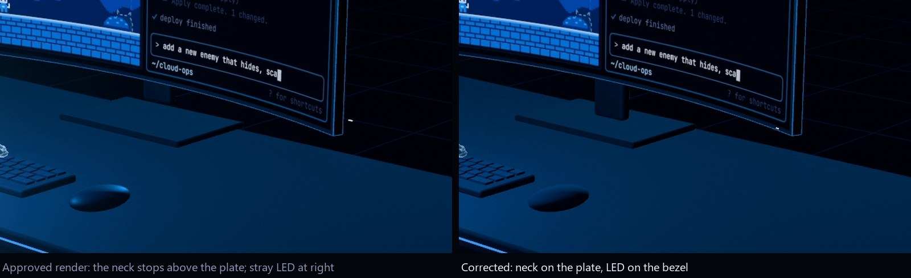 |
| A stray white dash floats right of the monitor | The power LED was positioned in flat coordinates beside a curved panel | The LED follows the panel's bend and sits on the bezel | same image |
| The figure is brighter than the monitor | Silhouette light at 2.0 with bloom at 0.85: his torso averaged luma 59 against 61 for the game picture, with brighter peaks (190 vs 180) | `rim` 2.0 → 1.25, `core` 0.4 → 0.32, spill light 0.5 → 0.35. Torso now averages 38 against 60 for the game (peaks 149 vs 179); the contour lines and the rim are unchanged in character | 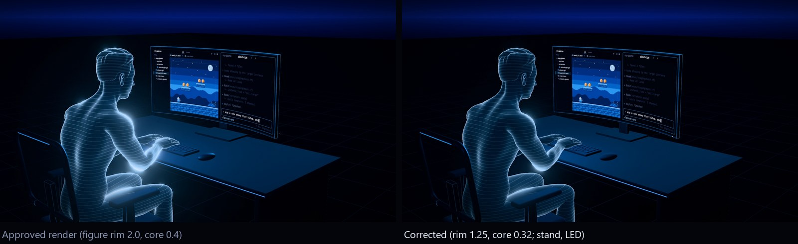 |
| The hand swallows the mouse; fingers curl onto the desk in front of it; the mouse glows purple | The wrist sat 26 mm behind the mouse, so the fingers overshot its front; a glossy shell mirrored the agent's light | The wrist rests 64 mm behind the mouse (heel of the hand on the desk, fingertips on the buttons); the mouse is matte | 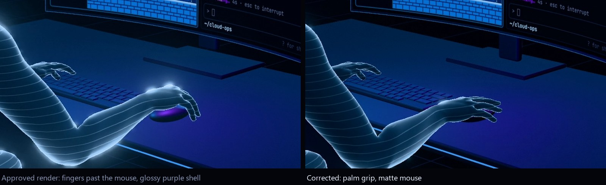 |
| In the insert, a new terminal line ghosts over the line above while it arrives | Its text was drawn while its row was still opening | The row opens first, then the text fades in (`repoScreen.ts`) | 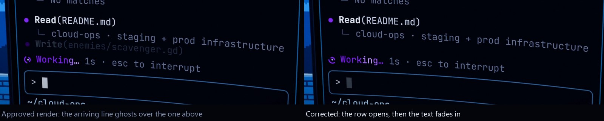 |

Pacing: 1.9 s of dead time removed from the timed export (typing beat 4.5 → 4.2 s, the "he carries on" beat 4.5 → 3.8 s, the final beat 4.5 → 3.6 s with its 1.0 s hold kept). The insert beat keeps its 4.5 s: it is the one the viewer has to read. The interactive version is unaffected: it still stops at every checkpoint for as long as the narrator wants. No camera key was added or moved.

The ending (requested during this pass): he no longer leans back; his posture stays as it is. In the last beat he makes the running game full screen. The terminal, with the agent still working in it, is simply covered, and its purple light goes with it. Nothing tells the viewer he forgot the agent; the picture does.

What was deliberately not changed: the figure, the palette, the two shots, the camera, the desk, the chair, the stage.

---

## 2. Annotated frames

Plain frames are in `docs/video-01/frames/`; the annotated ones below are the same frames with notes.

**Frame A · the wide shot** (beat `wp-type`). Establishes who, where, and the structure of the screen. Nothing in it needs to be read.

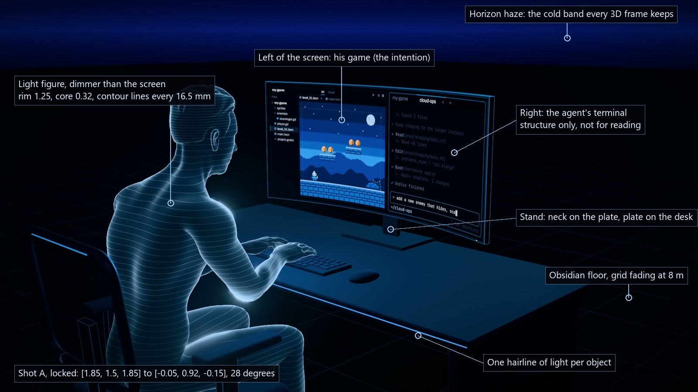

**Frame B · the insert** (beat `wp-send`). The only frame that must be read: intended project, active repository, the prompt, the agent starting.

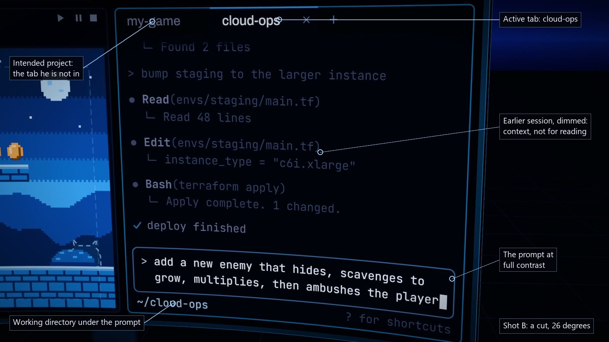

The same shot 2 s later: Enter has been pressed, the request has moved into the transcript and the agent's first lines say where it is.

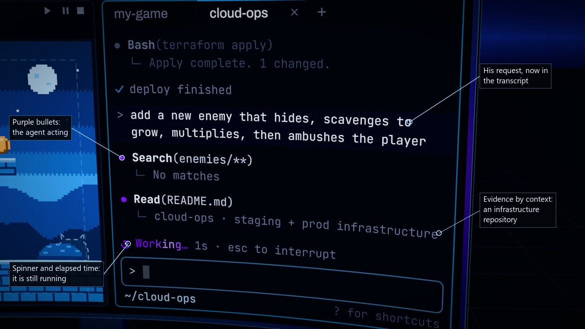

**Frame C · the outcome** (beat `wp-carry`). Back on the wide shot, unchanged camera. The story is in two small things: his hand on the mouse, and purple on the right.

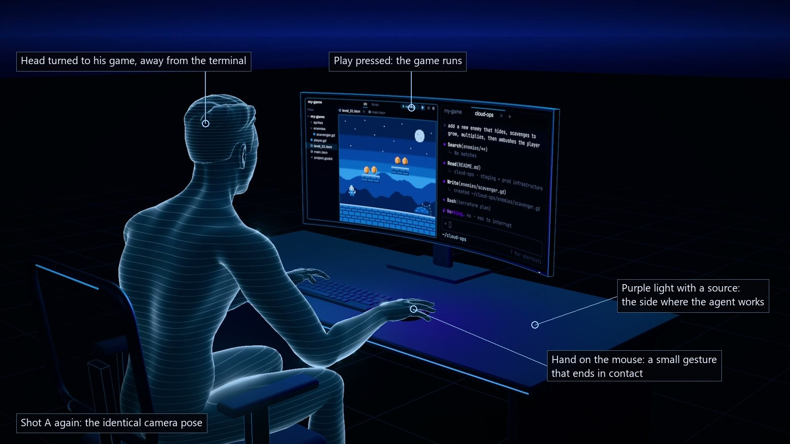

**Frame D · the last beat, before** (beat `wp-hold`, first second). The agent is still working; the purple is at its strongest.

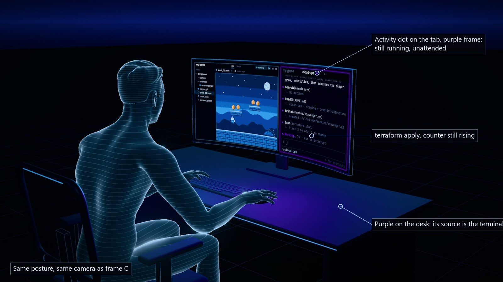

**Frame E · the last beat, after.** He makes the game full screen. The terminal is behind it; the frame is all blue again. Same posture, same camera.

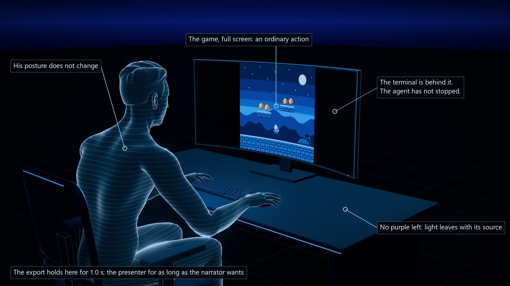

---

## 3. Theme tokens

Use roles, never raw hexes: `useTheme().tone.system.base`, `useTheme().color.void`. The `noir` theme freezes these values for the episode (the lab's `neon` theme has the same hexes today, apart from `safe`, but it is a sandbox and may drift).

### Palette

| Token | Hex | Use |
| --- | --- | --- |
| `color.void` | `#04050A` | Base of every frame. Never flat black. |
| `color.abyss` | `#070A14` | Lifted background, panel backing |
| `color.slate` | `#1A2032` | Unlit structure (mixed toward void for furniture) |
| `color.steel` | `#2B3654` | Hairlines on unlit structure, the floor grid |
| `color.haze` | `#16226A` | The horizon band |
| `color.white` | `#EAF2FF` | Tiny amounts only: a power LED, a caret |
| `color.text` | `#C4CFE6` | Interface text |
| `color.dim` | `#66718F` | Secondary interface text |
| `tone.system` | base `#2E9BFF`, hot `#A6D6FF`, deep `#0B3C9E` | People, ordinary activity, neutral systems, evidence chrome |
| `tone.mind` | base `#8B3DFF`, hot `#CDB2FF`, deep `#3B1290` | AI agents, autonomous processes, active computation |
| `tone.threat` | base `#FF2A3C`, hot `#FF949C`, deep `#7C0F1B` | Compromise, danger, escalation |
| `tone.inert` | base `#2B3654`, hot `#66718F`, deep `#1A2032` | Inactive marks |
| `tone.safe` | base `#4FD8FF`, hot `#C9F3FF`, deep `#0C4E6E` | Verified / passed. Bright cyan, not green: the episode has three hues. |
| `tone.human` | base `#FFB45C`, hot `#FFE1B8`, deep `#7A4410` | Only for art inside a screen (the game's coins). Never a light, never interface chrome. |

### Colour semantics

- **Blue / cyan** says "this is ordinary": John, his desk's edge light, a screen's glow, a finished job, a document frame.
- **Purple** appears when something acts on its own. In the reference it arrives in this order: the agent's bullets and spinner in the terminal, then a dot on the `cloud-ops` tab, then purple light on that side of the desk. Purple must have a source the viewer can point at, and it leaves with that source: when he covers the terminal with the full-screen game, the purple light on the desk goes too. The absence is the point of the final frame.
- **Red** is spent once per idea, at the moment of compromise or escalation. If a scene has no threat beat it has no red.
- The rule bends for readability, not for decoration: screen content keeps its own colours (a game is colourful; a real paper is black on white).

### Glow budget

Bloom is `strength 0.85, radius 0.72, threshold 0.92` (`video01.stage.bloom`). Only colours multiplied above about 0.92 glow, so glow is opt-in. In a frame, at most three things glow strongly, in this order of brightness: **the screen that carries the story, then the figure's rim, then one accent** (the agent's light or a hairline). If the figure outshines the screen, the frame is wrong (this was the main defect of the approved render).

### Type

- Interface text inside screens: JetBrains Mono, 31 px in the screen's 2048×880 design space (terminal), Archivo for window chrome.
- Labels on the frame itself are rare (the narrator carries the meaning). When needed: Archivo at 118 % width, weight 500, sentence case, never below 24 px at 1080p (`cyber.labelStyle`, `cyber.size`).

### Grade

`ShotGrade` on top of every 3D shot: vignette 0.5, grain 0.055, no scanlines, no tint (`theme.grade`). A static dither in the stage prevents banding in the dark gradients.

---

## 4. Character material

Component: `HoloPerson` (`src/components/cinematic/three/HoloPerson.tsx`), asset `public/models/john/john.glb` (CC0, Quaternius Universal Base Characters; eyes, brows, textures removed; re-proportioned to an ordinary 1.78 m man).

A human in this episode is **a featureless figure made of light**: real anatomy and proportions, no face, no clothes, no skin. It reads as "a person" and nothing more specific.

| Property | Value | Where |
| --- | --- | --- |
| Body colour (`core`) | `tone.system.base` × **0.32** | `video01.figure.core` |
| Silhouette + contour colour (`rim`) | `tone.system.hot` × **1.25** | `video01.figure.rim` |
| Body term | `core × (0.05 + 0.15·key² + 0.22·fresnel²)`, key = soft form light from above and from the screen side | `HOLO_FRAG` |
| Rim term | `rim × (1.3·fresnel⁵ + 0.03·fresnel²)`: thin and bright at the silhouette only | `HOLO_FRAG` |
| Contour lines | Horizontal slices in figure space every **16.5 mm** (7.5 mm on the hair), about 0.6 mm wide, anti-aliased in screen space, brighter toward the rim, faded where they crowd | `HOLO_FRAG` |
| Scan band | One soft band climbs the body every 14 s and lifts the lines by 0.4 as it passes | `scan` prop |
| Sparkles | About 1.2 % of 11 mm cells, twinkling slowly, attached to the body | `sparkle` prop |
| Toward the floor | Light thins to 50 % below 0.62 m | `HOLO_FRAG` |
| Spill | A point light at chest height, `tone.system.base`, intensity **0.35**, distance 1.3 m | `video01.figure.spill` |
| Shadows | Casts none, receives none | |
| Opaque | Yes (depth-writing); the chair's mesh back is drawn over him to veil him | |

Rules:

- **One model for everyone.** A second person is the same asset with different pose props, a different scale (±4 %) and, if they must be told apart, a different stance, never a different material. An AI agent is never a figure: agents are light on machines and marks in diagrams.
- **He is dimmer than what he looks at.** Keep `rim ≤ 1.3` and `core ≤ 0.35` unless a shot has no screen in it.
- **Poses come from props**, solved every frame (seated pelvis, spine lean, two-bone arm IK, per-finger curls): `typing`, `lean`, `headYaw`, `headPitch`, `toEnter`, `tap`, `reach`. Hands land on real surfaces: pass the keyboard, Enter key and mouse positions from the scene's `layout.ts`.
- **Gestures are small and finish.** A hand to the mouse, a head turn of 0.3 rad. If a gesture cannot be made to land convincingly, do not show the hands: frame from further back or cut to the screen.
- Known limits (accepted): heels lift about 2 cm in the chair (hidden by the desk in the wide shot); contour lines run lengthwise along forearms and thighs.

---

## 5. Environment

Component: `NoirStage` (`src/components/video01/NoirStage.tsx`) = `Stage3D` + the shot's lights + `HorizonHaze` + `ObsidianFloor`.

| Element | Treatment | Values |
| --- | --- | --- |
| Void | Background and fog are the same colour, so distance dissolves into it | `#04050A`; exponential fog density 0.018 |
| Horizon | A low, cold band of haze where the floor meets the void: the look's constant | `color.haze` `#16226A`, strength 1 |
| Floor | Unlit near-black plane (lights never wash it blue) plus a shadow catcher so things sit on it | `#04060C`; shadow opacity about 0.5 |
| Grid | Hairlines every **0.5 m**, fading to nothing at **8 m** from the origin | `color.steel` × 0.6 |
| Objects | Dark matte matter: `void` mixed 40 to 55 % toward `slate`, roughness 0.5 to 0.95, low metalness | see `Workstation.tsx` |
| Luminous edge | One hairline of light per object that matters (desk front edge 3.5 mm at 1.25; chair back top 2.8 mm at 0.9), plus thin blue outlines on the monitor (0.55) and chair (0.45) | `video01.edges` |

Rules:

- **Count the objects.** The reference has six (figure, chair, desk, monitor, keyboard, mouse) on the stage. Each one explains, gives context, or supports an action; write that purpose in the shot definition (`purpose:`). No plants, skylines, shelves, cables, wall art.
- **Everything touches something.** Feet of furniture on the floor, a stand on the desk, a neck into the housing, a hand on the mouse. Check contact from a second camera before approving a shot (the floating monitor was invisible in the editor's default view and obvious in the render).
- **No room.** There are no walls. Place is implied by the objects.
- **The grid is for shots with ground.** For a close-up of an interface, or a diagram-like 3D shot, use `<NoirStage floor={false}>` (void and horizon only) or a 2D scene.
- Real-world sizes in metres (desk 1.60 × 0.72 at 0.74 high, 45" curved monitor 1.04 × 0.447 with its centre at 1.075, seat at 0.48). Believable proportions are part of the look.

---

## 6. Lighting presets

Preset: `noirRig()` for a shot definition, or "Legacy / Digital Noir · Video 01" in the shot editor's lighting presets. Values in `video01.light`. Directional intensities are three.js physical units.

| Light | Kind | Colour | Intensity | Position → target | Job |
| --- | --- | --- | --- | --- | --- |
| `key` | directional, casts shadows | `#C9D6FF` | **0.75** | `[2.6, 4.6, 3.4]` → `[0, 0.8, 0]` | Form on the furniture, contact shadows |
| `fill` | directional | `#B8C6FF` | **0.18** | `[-4, 2.4, 4.5]` → `[0, 0.8, 0]` | Keeps the shadow side from going to pure black |
| `rim` | directional | `#2E9BFF` | **2.2** | `[-2.6, 2.1, -4.4]` → `[0, 0.95, 0.6]` | Low, from behind-left: grazes silhouettes, does not wash the desk top |
| `ambient` | ambient | `#8FA4FF` | **0.28** | | |
| `sky` | hemisphere | `#1C2A5C` over `#04050A` | **0.3** | | |

Practicals (light that belongs to an object; the shot scales it):

| Practical | Source | Colour | Level |
| --- | --- | --- | --- |
| `glow-screen` | Point light 0.45 m in front of the monitor, distance 3.2 m | `tone.system.base` | 1.6 × multiplier 1 |
| `glow-agent` | Point light in front of the part of the picture where the agent works, distance 2.2 m | `tone.mind.base` | 2.4 × `accentLevel` (0 while idle, rising to about 1.2 as the agent keeps working) |
| `figure-glow` | The figure's spill (section 4) | `tone.system.base` | 0.35 |

Stage: `noirStage()` = exposure 1, bloom 0.85 / 0.72 / 0.92, fog 0.018, shadows on, grade on.

Rules:

- **Light has a source.** Screens, the figure, hairline edges, the agent's accent. The rig only makes dark objects legible; it never becomes a visible "studio light".
- **Purple light is driven by the story**, not left on: its level is a function of the agent's activity (`accentLevel`).
- Do not raise `ambient` or `fill` to "see more". If something is unreadable, give it a hairline or move the practical.
- A darker scene (a machine left running): keep the rig, lower `key` to 0.35 and `ambient` to 0.16 ("Legacy night" in the editor), let the practicals carry the frame.

---

## 7. Camera conventions

Values in `video01.camera`. Reference cameras in `src/scenes/cinematic/02-wrong-project/layout.ts`.

| Shot | Position → target | Lens | Use |
| --- | --- | --- | --- |
| A · wide | `[1.85, 1.5, 1.85]` → `[-0.05, 0.92, -0.15]` | 28° vertical | Three-quarter from behind his right shoulder, slightly above eye level; the whole workstation with negative space to the right |
| B · insert | `[0.35, 1.25, 0.75]` → `[0.295, 1.075, -0.233]` | 26° | Nearly frontal on the terminal half of the screen, standing clear of his head |
| B · push | → `[0.345, 1.239, 0.69]` over the 4.5 s beat | 26° | 62 mm of travel: felt, not seen |

Rules:

1. **Default: locked.** One wide shot per scene, the same pose at every checkpoint in which it appears. The shot editor's test for this is literal: checkpoint 1 and checkpoint 4 of the reference are the same picture outside the moving parts.
2. **A close-up is a cut**, never a travel: a camera key with `cut: true`, placed `0.01` s into its beat so each presenter hold keeps its own shot. Cut back to the same wide pose.
3. **A close-up must show something the wide cannot.** In the reference: the tab names, the path under the prompt, the agent's first lines. If the wide already tells it, stay wide.
4. **Movement inside a shot: a push of at most 0.07 m per beat**, on inserts only, eased in and out. Nothing else.
5. **Lenses**: wide 24 to 34°, inserts 20 to 30°. No wide-angle distortion, no dolly zoom.
6. **Composition of the wide**: the subject in the left two thirds, looking into the frame; the horizon band across the top fifth; negative space kept empty on purpose.
7. For an insert on a screen, compute the camera instead of nudging it: `screenInsert(MONITOR, REPO_SCREEN_LAYOUT.terminal, {fill: 0.9, yaw, pitch})` (`src/shot/cameras.ts`). Raise `yaw` / `pitch` until the figure's head is out of frame; keep yaw under about 8° or the text shears.

Not allowed: orbits, continuous left / right drift, sweeps between beats, a new angle "for variety", handheld shake, rack focus as decoration.

---

## 8. Animation grammar

Everything is a function of the Remotion frame through the beat engine (`useMotion(cue)`, `useActiveTime()`): no timers, no `useFrame` clocks, no CSS animation. A hold is a frozen frame; the live presenter can rest on any checkpoint indefinitely and the export gives it `hold` seconds.

A scene is **four beats or fewer**, in this order (the reference's beats in brackets):

| Beat | What moves | Shot |
| --- | --- | --- |
| Establish (`wp-type`, 4.2 s) | One ordinary action in progress (he types) | Wide |
| Trigger (`wp-send`, 4.5 s) | One decisive change, shown close (Enter; the agent starts in the wrong repository) | Insert |
| Outcome (`wp-carry`, 3.8 s) | The consequence, and the person not noticing (hand to mouse, head to the game, play) | Wide |
| Close (`wp-hold`, 3.6 s + 1.0 s) | One last ordinary action that carries the meaning (he makes the game full screen; the terminal, still working, is covered and its purple goes), then rest | Wide |

Vocabulary, in order of preference:

1. **Real changes on a screen**: text typed at typing speed (about 20 characters a second), a line arriving, a tab's activity dot, a game starting to run. Painted per frame by a pure canvas painter (`paintRepoScreen`).
2. **Small human gestures**: 0.6 to 1.0 s each, eased in and out, ending in contact.
3. **Light changing level**: a practical rising with activity over seconds, a pulse on something already established. Never a flash.
4. **A posture change**, rarely, and only when the story needs it: about 2 s. The reference shot ends without one; he stays as he is.
5. **An object transforming to explain a mechanism** (2D or 3D diagrams): one transformation per beat.

Timing tokens (`video01.motion`): flip 0.25 s, gesture 1.0 s, posture 2.0 s, reading time before anything happens in an insert 1.4 s, export hold 1.0 s.

Rules:

- One idea per beat. If two things must change, they overlap by at most 0.3 s and one of them is clearly secondary.
- Nothing appears without a cause in the picture. No particles, no code rain, no HUD rings, no objects flying in.
- After a beat's action ends, the frame rests. Dead time in the export is trimmed in the beat durations, never by adding motion.
- Typing, breathing and the agent's spinner run on active time, so they hold still during a presenter pause.

---

## 9. Interfaces and source panels

### Software on screens

- Looks like software someone uses: an engine editor with a file dock and play controls; a terminal with tabs, a transcript, a prompt box and a working directory. Generic, no real product names or logos.
- **The mistake is carried by structure, not labels.** Left = intention (the game), right = where the task went (the active tab, `~/cloud-ops`, a README about infrastructure). Nothing on screen says "wrong". Forgetting is shown the same way: an ordinary action (full screen) hides the thing that mattered.
- Two reading distances: in the wide shot only the structure must read (game left, agent right, purple on the right); in the insert every relevant line is readable (31 px mono in a 2048×880 picture, rendered at 3072×1320 in exports).
- The picture is unlit and exact (`meshBasicMaterial`, no glass reflections). The monitor is a physical object with a stand that reaches the desk.
- Reuse: `CurvedMonitor` takes any canvas texture (`useScreenTexture(w, h, painter)`); `paintRepoScreen` is the game + coding-agent interface; a new interface is a new pure painter with the same signature.

### Real-world evidence

Components (2D, `src/components/video01`): `SourcePanel` + `PassageHighlight` for documents and articles, `MediaPanel` for images and clips, `CyberFrame` + `RegionHighlight` for anything else.

- **The source is never restyled.** A paper stays black on white, a screenshot keeps its colours. Our language is only the frame: corner brackets and hairlines in `tone.system`, a caption line under it.
- One short caption, sentence case: what it is and the credit. An optional dimmer `meta` on the right (date, outlet).
- To direct the eye, dim everything except the measured passage (`PassageHighlight`, `dim` about 0.6) or push in on a region (`MediaPanel region` + `zoom`, at most 3×). Never draw on top of the text.
- Evidence chrome is blue. It turns purple or red only if the source itself is the agent or the threat.
- Panels arrive by building their frame and opening an aperture (`build`, `open`), and leave the same way (`exit`). No flips, no glitch transitions.
- Clips are frame-driven (`useMediaTime`): a presenter hold freezes them on one frame.
- Keep the frame around evidence plain: void background, at most a faint horizon. No floating 3D panels in a room, no extra HUD.

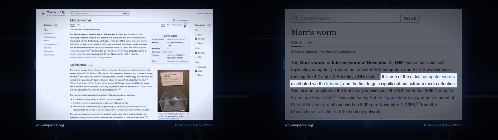

The existing panels rendered with `--theme=noir` (stills from redesign scene 06, `npm run story:stills -- 06-source --theme=noir`): the document at reading size, then the measured passage lit with the rest dimmed. Only the panel treatment is the reference here; that scene's background diagram and its tilted arrival predate this guide.

---

## 10. 2D or 3D

| The beat is about | Use | Why |
| --- | --- | --- |
| A person doing something at a place (John coding, John returning) | 3D reenactment on `NoirStage` | The figure and its light are the episode's signature |
| A machine left running, a server executing a process | 3D, same stage, no figure, one object | Absence of the figure is the point; keep one practical light |
| The exact thing typed, clicked or printed | Insert on the 3D screen (cut), or a 2D interface scene if no 3D scene surrounds it | Readability |
| A mechanism (one process becoming several, a scanner's coverage, services connected to agents) | 2D or 2.5D diagram in the same palette | A diagram explains; a room would only decorate. Do not put a figure in it |
| A real document, article, screenshot, clip, meme | 2D source / media panel | It must be recognisable as genuine |
| Scale (many machines, many agents) | 2D first; 3D only if depth itself is the argument | Object count |

Tests to apply before building: Does a human need to be in this picture? Would the same idea read in a still? Is there anything in the frame the narration will not mention? If the first answer is no, it is probably 2D.

2D scenes keep the same language: `color.void` background with the horizon band at 64 % of the height when a horizon helps (`theme.backdrop = 'horizon'`), hairlines at 1.25 px, the same three hues with the same meanings, the same beat grammar, no camera moves beyond a modest scale change.

Transitions between treatments: a direct cut, a short fade through the void (0.3 to 0.5 s), or a matched shape (the monitor's rectangle becomes the panel's rectangle; a node keeps its place). No wipes, no zoom-throughs, no glitch.

---

## 11. Anti-patterns

Each of these has already been tried in this repository and rejected.

| Do not | Instead |
| --- | --- |
| Travel the camera between beats, orbit, drift | Lock it; cut to an insert |
| Build the room, the street, the city | Six objects on the stage |
| Add a prop for realism (plant, lamp, mug, cables) | Leave the space empty |
| Let the figure be the brightest thing | Screen first, then the rim |
| Replace the figure with a low-poly mannequin, give it a face or clothes | `HoloPerson` as is |
| A new person model per scene | The same asset, new pose |
| Float anything: a monitor without a stand, a hand above a mouse | Model the contact, check it from a second camera |
| Glossy shells and glass that mirror the practicals | Matte matter |
| Make every terminal line readable in the wide shot | Structure in the wide, text in the insert |
| Write "WRONG", arrows, warning icons on the interface | Let the path and the tab say it |
| Purple or red as decoration | Purple = an agent acting; red = the moment of compromise |
| Green for "ok", amber for warmth | Bright cyan for "verified"; amber only inside game art |
| Particles, code rain, HUD rings, scan lines over the frame | Nothing |
| Flashes, shakes, glitch transitions | Levels that rise over seconds; cuts and short fades |
| Fill dead time with motion | Shorten the beat |
| Restyle a source to match the palette | Frame it, dim around the passage |
| Warm practical light, brown wood, daylight | The episode has no warm light |
| Heavy bloom (strength above 1), exposure above 1 | The budget in section 3 |
| Timers, `useFrame` loops, CSS keyframes, browser-only state in a composition | Frame-driven cues |

---

## 12. Applying the style to a new scene

### A 3D reenactment

1. **Write what a muted viewer should understand**, in four beats or fewer (section 8). Decide the one thing the insert must show.
2. **Lay out the set in metres** in `layout.ts` (copy `02-wrong-project/layout.ts`): only the objects the beats need.
3. **Define the shot** with the episode's presets:

```ts
// src/scenes/cinematic/NN-name/shot.ts
import {noirStageObjects} from '../../../components/video01/NoirStage';
import {defineShot, noirRig, noirStage, type ShotPatch} from '../../../shot';
import {video01} from '../../../styles/video01';
import approved from './shot.json';

const E = video01.edges;
export const shot = defineShot({
  id: 'cine-NN-name',
  title: 'XNN · Name',
  approved: approved as unknown as ShotPatch,
  approvedPath: 'src/scenes/cinematic/NN-name/shot.json',
  objects: {
    ...noirStageObjects(), // horizon + obsidian grid floor ({floor: false} for void only)
    desk: {label: 'Desk', group: 'Workstation', purpose: 'Context: he is at work.', slots: {top: 'Top', legs: 'Panel legs', edge: 'Front-edge light'}},
    monitor: {label: 'Monitor', group: 'Workstation', purpose: 'Explains: ...', defaults: {edges: {enabled: true, color: E.color, intensity: E.primary, threshold: E.threshold}}, slots: {body: 'Body', screen: 'Picture'}},
    developer: {label: 'John', group: 'People', purpose: 'The subject.', slots: {core: 'Body light', rim: 'Silhouette + contour light'}},
  },
  lights: {
    ...noirRig(),
    'glow-screen': {label: 'Screen glow', role: 'practical', defaults: {kind: 'practical', intensity: 1, color: ''}},
    'glow-agent': {label: 'Agent light', role: 'practical', defaults: {kind: 'practical', intensity: 1, color: ''}},
    'figure-glow': {label: 'Figure spill', role: 'practical', defaults: {kind: 'practical', intensity: 1, color: ''}},
  },
  camera: {mode: 'locked', locked: true, position: WIDE.position, target: WIDE.target, fov: video01.camera.wide.fov},
  stage: noirStage(),
  motions: {
    // one cue per thing that changes; times are seconds into the beat
    'type-prompt': {label: 'He types', beat: 'b-establish', from: 0.3, until: 3.9, easing: 'linear'},
  },
});
```

4. **Build the scene** from the kit:

```tsx
// src/scenes/cinematic/NN-name/Scene.tsx
import {NoirStage, HoloPerson, StudioDesk, CurvedMonitor, useScreenTexture, video01} from '../../../components/video01/three';
import {ShotObject, useMotion, usePractical} from '../../../shot';

<AbsoluteFill>
  <NoirStage>
    <ShotObject id="desk"><StudioDesk desk={DESK} /></ShotObject>
    <ShotObject id="monitor">
      <CurvedMonitor monitor={MONITOR} deskY={DESK.top[1]} map={screen} tint={th.tone.system.base}
        glow="glow-screen" accent="glow-agent" accentTint={th.tone.mind.base} accentLevel={agentActivity} />
    </ShotObject>
    <ShotObject id="developer">
      <HoloPerson position={CHAIR.floor} pose={pose} time={time} keyboard={...} enter={...} mouse={...} chair={CHAIR} />
      <pointLight position={[x, 0.95, z]} intensity={video01.figure.spill * figureGlow.intensity} color={figureGlow.color} distance={1.3} decay={2} />
    </ShotObject>
  </NoirStage>
</AbsoluteFill>
```

   The composition is `shotComposition(shot, baseEpisode)` with a `ShotGrade` layer, as in `02-wrong-project/index.tsx`; register it in `src/videos/style-lab/cinematic.ts`.
5. **Add the insert as camera keys** in `shot.json` (wide at `t: 0`, a `cut: true` key `0.01` s into the trigger beat, a `cut: true` key back to the wide pose `0.01` s into the next beat). Use `screenInsert` for a screen.
6. **Review on localhost first** (`npm run dev`, `/style-lab/cine-NN-name?theme=noir`, → through every beat). Render only after the look is approved there.

### A 2D scene (diagram or evidence)

Build it like the scenes in `src/scenes/redesign` (a `story` composition with a `theme` prop), import from `src/components/video01`, and view it with `?theme=noir`. Follow sections 9 and 10.

### Review checklist

Run through this on rendered frames, not in the editor:

- [ ] Every object touches what it stands on (look from a second camera).
- [ ] The screen that carries the story is the brightest thing; the figure is second.
- [ ] Wide shot: the same picture at every checkpoint it appears in.
- [ ] Insert: every line the narration relies on is readable at 1080p; nothing else competes.
- [ ] Purple has a visible source and rises with the agent's activity; red appears once or not at all.
- [ ] Object count justified one by one.
- [ ] No motion after a beat's action ends; no dead second in the export.
- [ ] Hands end in contact, or are not shown.
- [ ] `npm run typecheck`, `npm test`, and a render of the scene succeed.

Commands:

```bash
npm run dev                                                       # live Style Lab
node scripts/dev/preview.mjs cine-02-wrong-project noir           # checkpoint screenshots of the live Player
npm run cine:stills -- 02-wrong-project --theme=noir --frames=120,382,682,1000 --scale=1
npm run cine:stills -- 02-wrong-project --shot=path/to/debug-camera.json   # inspect contact from another angle
npm run cine:render -- 02-wrong-project --theme=noir              # after approval on localhost
```

---

## 13. Changing the style

The style is provisional and belongs to this episode.

- **A number** (figure brightness, a light, bloom, an edge): change it in `src/styles/video01.ts`. The reference shot, the lighting preset and the figure all read it. Re-render the reference stills and compare.
- **A colour**: change the `noir` theme in `src/styles/themes.ts`. Other themes are untouched.
- **A rule**: change this document and the anti-pattern table together, and note the date and the shot that motivated it below.
- **Another episode**: add `src/styles/videoNN.ts` and its own theme and guide; do not edit this one into a global standard.
- A shot can still deviate through its `shot.json` (the shot editor writes it). A deviation that survives two shots should become a token.

### Change log

| Date | Change | Motivated by |
| --- | --- | --- |
| 2026-11-11 | Language extracted from X02. Figure 2.0 / 0.4 → 1.25 / 0.32, spill 0.5 → 0.35; stand, LED, mouse grip, line reveal fixed; export trimmed 19.9 → 18.0 s | Review of the approved render |
| 2026-11-11 | X02 ending: no posture change; the game goes full screen over the terminal and the purple leaves with it. Rule added: light leaves with its source; posture changes are rare | User direction ("show, not tell") |
