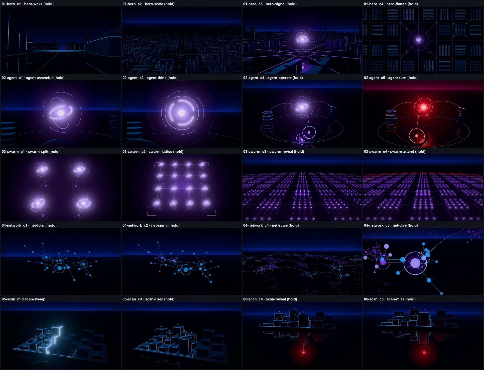
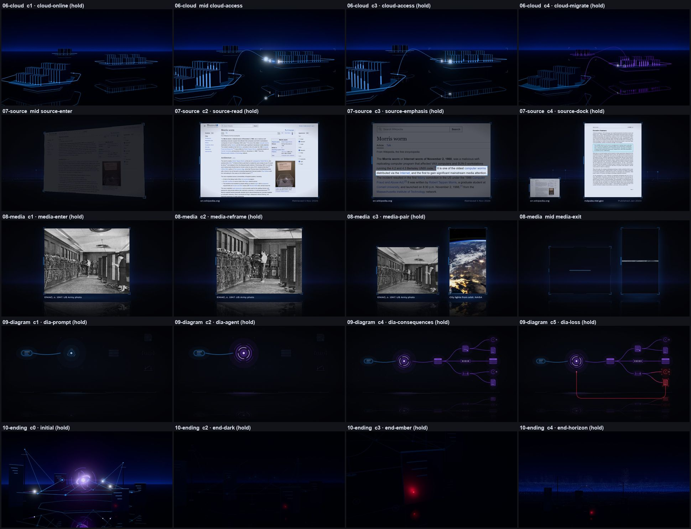
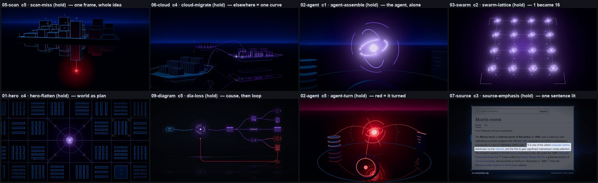
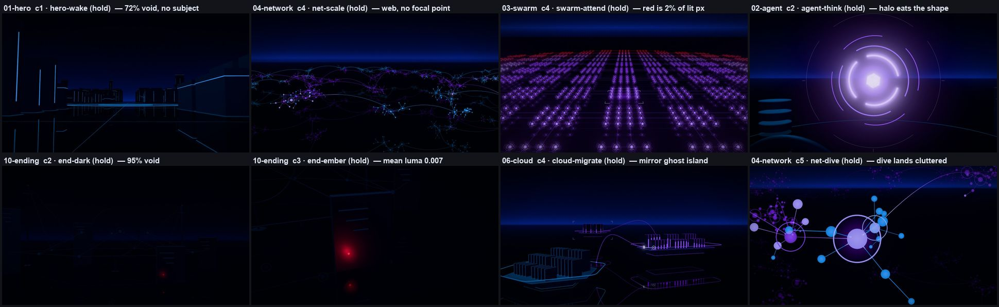

# Legacy Experiments: the reference

The first ten Style Lab samples are the visual standard for every new scene. This document says what they are, why they work, where they fail, and how to stage the six story moments in their language. When a design choice is unclear, use the legacy approach. If realism conflicts with it, the legacy approach wins.

How this was made: all ten samples were rendered through the export path (`node scripts/lab.mjs stills <slug>`, half scale), at frame 0, the middle of every beat and every beat checkpoint, 98 frames in total. Every frame was looked at. Pixel figures (void, luminance, colour shares) were measured on those frames. Camera distances were computed from the `useCameraRig` keys in each `*Scene.tsx`. The "Not detected" and "Rogue agent" demos and the 2D redesign S01 were rendered for context only. Method and definitions are in the appendix.

---

## 1. What the Legacy Experiments are

**Commits.** The repository starts with two commits on 2026-11-04: `640cadc` (`first`, README only) and `236b5b1` (`Initial commit`), one minute later. `236b5b1` imports everything at once: the beat engine, the two editorial demos and the ten Style Lab samples. Git cannot order them further. `docs/STYLE_LAB.md` (same commit) says the samples were "built on the existing beat engine", so the engine demo came before them.

| Set | Folder | Look | Role here |
| --- | --- | --- | --- |
| "Not detected ≠ does not exist" (engine demo, 4 scenes, 11 beats) | `src/scenes/not-detected` | Ink / paper editorial: charcoal `#0C0D0F`, cream type, teal `#8FE3CF`, orange-red `#FF5B35` (`src/styles/theme.ts`) | Context. Same idea as moment 5, different look. |
| Rogue agent intro (John's story, about 90 s) | `src/scenes/rogue-agent` | Same editorial look, headline type and UI labels in most frames | Context. First telling of the story. |
| **The ten Style Lab samples** | `src/scenes/style-lab/01-hero` … `10-ending`, shared parts in `src/components/cyber`, tokens in `src/styles/cyber.ts` | "Obsidian neon": void, horizon band, mirror floor, blue / violet / red | **These are the Legacy Experiments.** |
| 2D story redesign S01–S10 | `src/scenes/redesign` | Neon theme plus warm "human" colours, pixel-art game | Later (`080d0fe` … `88c661f`, 2026-11-05). |
| Cinematic 3D X01–X06 | `src/scenes/cinematic` | Fern-informed rooms, streets, halls | Later (`c1d43ba`, 2026-11-08). These are what needs correcting. |

The ten samples are "the Legacy Experiments". The gallery shows them under **Legacy experiments · the original ten** (`src/player/lab/StyleLabApp.tsx`), and `docs/STYLE_LAB_V2.md` §1 names them the baseline. The two editorial demos are equally old, but they use a different look: text in almost every frame, and teal and orange instead of blue, violet and red. Use them for story beats, not for the look.

**Have they changed since?** No, not in a way that changes the look.

- `git diff 236b5b1 HEAD -- src/scenes/style-lab src/styles/cyber.ts` is empty.
- Shared components did change (`src/components/cyber`, `src/engine/EpisodeComposition.tsx`; commits `87ef9b8`, `c1d43ba`, `e37786c`, `0532294`):
  - colours now come from a theme context, and the default `neon` theme equals the `cyber.ts` tokens;
  - `Stage3D` gained opt-in shadows (off by default), orthographic cameras, the shot-editor context bridge, and a live-Player quality mode;
  - layers ignore pointer events.
- The quality mode affects only the live Player. By default it renders 3D at 0.66 internal scale with 2x MSAA, so the Player looks slightly softer than an export. Exports and `lab.mjs` still render at full quality.
- The gallery registry `src/videos/style-lab/registry.ts` was reconstructed in `fef4a17`, because `.gitignore` had swallowed `src/videos/`. It only holds titles and one-line ideas. The beat timings live in each sample's own `index.tsx`, which is original.
- The poster thumbnails `public/lab/thumbs/01-hero.jpg` … `10-ending.jpg` are unchanged since `236b5b1`.

**How to open them.**

| What | How |
| --- | --- |
| Gallery | `npm run dev`, then http://localhost:5173/style-lab, section "Legacy experiments" (keys `1`–`0` open a sample) |
| One sample | `/style-lab/05-scan`. `→` plays the next beat, `←` goes back, `H` shows the beat HUD, `[` / `]` go to the previous / next sample |
| As a scene's "Original" | `/style-lab/07-undetected?concept=original` opens 05-scan. Same pattern: S04 → 03-swarm, S06 → 07-source, S08 → 06-cloud, S09 → 08-media, S10 → 10-ending |
| Frames from the export path | `node scripts/lab.mjs stills 05-scan [--out=<dir>]` gives frame 0, every mid-beat and every checkpoint at half scale. It rewrites the tracked `.lab/entry-05-scan.tsx` with identical content |
| Beat sheet | `node scripts/lab.mjs info 05-scan` |
| MP4 | `npm run lab:render -- 05-scan` writes `out/style-lab/05-scan.mp4` |

---

## 2. The frames

Every sample at four of its checkpoints (or mid-beat where the motion is the point). "(hold)" marks the frozen frame at the end of a beat.

The holds to design toward, and the frames not to repeat:

---

## 3. Why they work: nine principles

### P1. One idea per sample, one change per beat, then stillness

Every sample is about 12 s long with 4–5 beats. Each beat animates for 1.0–3.4 s (median 1.8 s) and then the frame freezes. Ambient motion runs on `useActiveTime()`, so a hold does not drift. Each beat changes one thing:

- **05-scan:** brackets draw (1.2 s), the sheet sweeps and ticks appear (2.4 s), the scan settles (1.0 s), the camera looks under the floor (2.4 s), the red core flares (1.3 s).
- **03-swarm:** each of the first two beats doubles the count, and nothing else changes.
- **02-agent:** beat 5 changes only colour.

You can name each beat with one verb.

### P2. A cast of one to five things; quantity only when quantity is the message

The strongest holds have very few objects:

- 02 c1: 1 object.
- 02 c4: 5 objects (agent, three tools, ring).
- 05 c5: one board and one red core.
- 06 c4: three islands and a curve.
- 07 c3: one page and one sentence.
- 09 c5: one causal chain of 12 small icons.

The weakest holds have thousands with no hierarchy: 01 c2 (2,102 slabs), 04 c4 (1,171 nodes in 43 clusters), 03 c4 (1,222 agents). The measurements agree:

- The brightest 0.5 % of pixels sit within 2–6 % of the frame width in the single-subject holds (01 c3, 02 c1–c2, 10 c1).
- In 01 c1–c2, 03 c3–c4 and 04 c4 they spread over 24–34 % of the width. The eye has nowhere to land.

03-swarm is the one case where the count is the message. Even there, the image that reads is the bracketed 4×4 cell (c2), not the field.

### P3. The void is half the frame or more, but never all of it

In the best holds, 51–71 % of pixels are essentially black (below 8 % brightness): 05 59–71 %, 06 51–56 %, 01 c4 69 %, 04 c1–c3 61–72 %. The horizon band is the one constant light. Fail cases exist on both sides:

| Failure | Frames | Measurements |
| --- | --- | --- |
| Too full | 03 b1–b2 | 8–18 % void; bloom tints the whole frame violet |
| Too empty | 10 c2–c3 | 95–96 % void, mean luminance 0.006–0.007 (a black frame with a red dot) |
| Too empty | 01 c0 | 99 % void |
| Too empty | 09 throughout | 88–96 % void; brightest pixels only about 55 % |

### P4. Colour is the caption

- **Blue for systems.** In system frames, blue is 75–100 % of lit pixels (05 c0–c3: 99–100 %; 06 c0–c3: 97–100 %; 04 c1: 100 %).
- **Violet only where an agent is or has been.** In 04 c2, only the hop path is violet. In 06 c4, the meters turn violet where the agent's workload arrived. In 02 c4, the tools the agent touched take on violet.
- **Red late and small.** Red first appears in beat 5 of 5 (02, 09), beat 4 of 4 (03) and beat 4 of 5 (05). It is at most 25 % of lit pixels (05 c5: 14 %, 09 c5: 24 %, 03 c4: 2 %). The deliberate exceptions are 02 c5, where everything turns red (94 %) because the point is total takeover, and 10-ending, where red is a single LED present from frame 0.
- **The shape stays and the colour changes.** The red agent in 02 c5 has the same geometry as the violet one.

### P5. Glow budget: one hot thing per hold, three at most

The holds that read instantly each have exactly one white-hot or saturated point:

- 05 c5: the red core.
- 06 b3: the token's comet head.
- 02 c1: the agent's core.
- 01 c4: the violet node.
- 10 c3: one LED.

Frames that break the budget:

- 03 c2: 16 hot cores; 12 % of the frame is above half brightness.
- 02 c2: the halo covers 11.5 % of the frame and the rings dissolve into it.
- 07 c2: the open white page covers half the frame above half brightness. It is the brightest frame in the set and steals the eye from the one sentence that matters.

### P6. The camera stays; when it moves, the move is the argument

| Sample | Camera path | Beats that move | Largest single move | fov |
| --- | --- | --- | --- | --- |
| **05-scan** | 5.0 m | 3 of 5 | 4.0 m down and back; look-at drops 2.5 m under the floor (the reveal) | 34 fixed |
| **06-cloud** | 8.2 m | 4 of 4 | 3.1 m at 12–17 m from the subject (≤ 20 % of distance) | 34 fixed |
| **09-diagram** (2D) | one move | 1 of 5 | zoom 1.25 → 1.0, pan 170 px, to fit the growing chain | n/a |
| **07 / 08** (2D) | inner reframe | 1–2 of 4 | push onto the passage / detail (08: ≤ 2x) | n/a |
| 02-agent | 14.4 m | 5 of 5 | 7.0 m pull-back, subject distance 5.1 → 11.1 m | 34 fixed |
| 10-ending | 20.4 m | 4 of 4 | 14.1 m pull-back with the look-at rising 24 m (tilt to horizon) | 34 fixed |
| 03-swarm | 70.6 m | 3 of 4 | 50.6 m pull-out, subject distance 22 → 83 m | 34 → 42 |
| 04-network | 121.7 m (+5 m bow) | 5 of 5 | 76 m dive to 4 m from one node | 34 → 40 → 34 |
| 01-hero | 1,461 m | 4 of 4 | dolly-zoom to a plan view about 1.3 km up | 34 → 2.6 |

The order matches the quality of the holds. The two samples whose camera barely moves (05, 06) have the clearest frames. The three that travel most (01, 03, 04) have the weakest. 05-scan's sweep drift is 0.46 m at 11 m (4 %), which is effectively still. Its one real move, looking under the floor, is the argument of the sample. 03 holds still through the first division (the first 0.5 s of beat 1) so it reads, and its strongest frames (c1–c2) come from that stillness.

### P7. The answer is in the first frame; reveal it by looking, not by spawning

05-scan's red agent "is there from frame 0; the first three beats simply never look down" (`ScanScene.tsx`, header). Other samples do the same:

- 10-ending's ember is already a red dot in c0.
- 01-hero puts an empty target ring in the plaza (c2) one beat before the agent arrives there (c3).
- Cause comes before effect everywhere:
  - in 09, each line draws from its source before the target ignites;
  - in 06, the token travels, then the gate opens, then the meters change;
  - in 04, the hop path draws, then the cascade follows.

The viewer always sees where a change comes from.

### P8. Instruments, not props; almost no words

Everything is made of the same few parts:

- dark slate bodies with luminous edges;
- hairline rings and corner brackets;
- tick marks;
- comets (a white head with a coloured tail);
- the gimbal iris for any agent.

There is no texture, no furniture, no face. Objects read by role, position and colour rather than by detail: modules on a board are "a system", plates of racks are "a provider", a capsule with lines is "a prompt".

The 3D samples and 09 contain no words at all. 07 and 08 have one caption per panel (source domain and date, or source and year). The editorial demos rendered for comparison have a headline or UI label in nearly every frame. That is the difference between the channel's look and a slide.

### P9. One constant stage, and decide what the mirror means

Void, horizon band and obsidian floor appear in every 3D sample, and as flat hairlines (`SceneAtmosphere`) in the 2D ones. That shared stage is why ten different ideas look like one channel.

The mirror floor can also create a second reading:

- 06 c4: the purple island's reflection looks like a second island stacked under it.
- 02 c3–c5: the agent's reflection sits under the gate ring and reads as a sixth object.
- 01 c3: a second violet sphere appears in the foreground.

05-scan is the exception that proves the rule. It hides the red agent where only reflections should be, so the mirror carries the meaning. Check every reflection: it either means something or is cut.

---

## 4. Per sample

Durations are at 60 fps. "cN" is the hold at the end of beat N. Object counts come from the sample's data files.

### 01 · Cinematic opening (Hybrid, 4 beats, 11.9 s)

- **Idea:** compute is a city; an AI arrives at its centre; the world becomes a map.
- **Metaphor:** a dark city of slabs with blue seams; eight comets converging on the plaza; the violet iris; a dolly-zoom that flattens the city into a plan diagram.
- **Elements:** 2,102 slabs (instanced), 8 routes, 1 agent, plaza rings, plan overlay.
- **Camera:** every beat moves: a 9 m dolly, a 70 m crane up, 68 m back down, then a dolly-zoom from fov 34 to 2.6. Total 1,461 m.
- **Excellent:** c4 is the cleanest frame in the set: one violet node, centred, blocks drawn as hairline rectangles, corner brackets on a neighbour. "The world becomes a diagram" is a strong move to use once per film. The empty plaza ring in c2 sets up the arrival.
- **Weak:** the first beat (2.3 s) is nearly empty: c0 is 99 % void at mean luminance 0.005, and c1 is 73 % void with a thin lit platform as its only subject. c2 is 2,102 dim slabs with no lit subject. In c3, the agent's reflection pokes up between the foreground slabs as a second violet object. Too much travel. The thumbnail (c3) suggests a better sample than the first three beats deliver.

### 02 · A single agent (3D, 5 beats, 12.4 s)

- **Idea:** an agent is a mind that reaches into tools and acts; then it turns.
- **Metaphor:** the gimbal iris (core, faceted shell, three broken rings); three tools on a hairline ring: data (disc stack), exec (slab with lines), gate (ring with a dot). Arcs reach out; touched tools take on violet; the whole thing turns red.
- **Elements:** 5.
- **Camera:** 14.4 m, every beat. A 2.2 m push-in, a 1.0 m drift, then a 7.0 m pull-back that doubles the subject distance to reveal the tools, then 1.8 m and 2.3 m drifts. fov fixed.
- **Excellent:** c1 is the channel's character in one image. c5 says "it turned" with nothing but colour. Five objects are enough to explain an agent.
- **Weak:** in c1–c2 the halo spans about a third of the frame width and the rings melt into bloom. The core's reflection sits under the gate ring and reads as an extra object. The exec and gate tools are not identifiable without narration. The tools only appear when the camera pulls back in beat 3, so the frame changes scale mid-sample.

### 03 · Replication (3D, 4 beats, 11.95 s)

- **Idea:** one becomes many, then very many; they notice you; the far edge goes red.
- **Metaphor:** cell division 1 → 2 → 4 → 8 → 16 into a bracketed 4×4 lattice; the lattice is one cell of a field.
- **Elements:** 16 hero agents, then 1,222 instanced agents and 2,077 links.
- **Camera:** 70.6 m. Still through the first division (0.5 s), then two crane-ups (8.6 m, 11.4 m), then a 50.6 m pull-out with fov 34 → 42. The last beat is static.
- **Excellent:** beats 1–2 are the clearest replication image in the repo. Identical copies appear in place, the count is countable, and the cell is bracketed.
- **Weak:** violet everywhere. Void drops to 8–33 %, the lowest in the set, and the bloom hazes the whole frame. The wide (c3–c4) is a uniform field; the original cell keeps only a small bracket. The red edge is 2 % of lit pixels on the horizon line, absent from the gallery thumbnail and easy to miss. The "everyone turns to face you" beat does not read at that distance.

### 04 · The network (3D, 5 beats, 11.95 s)

- **Idea:** a network carries one signal; activity spreads; the network is one of many.
- **Metaphor:** a node-link graph; a comet hopping along a path; a colour wave by graph distance; a web of clusters.
- **Elements:** 32 nodes locally; 1,171 nodes, 43 clusters and 1,239 edges in the wide.
- **Camera:** 121.7 m, every beat. Three drifts of 2–3 m, a 38.6 m pull-out (fov 34 → 40), then a 76 m dive that bows 5 m up and lands 4 m from one node.
- **Excellent:** c2. The hop path is the only violet in a blue cluster, and you can follow the signal node by node. c3 shows the whole cluster turned.
- **Weak:** c0 shows nothing (80 % void). The wide (c4, also the gallery thumbnail) is a web with no focal point. The dive is the longest move in the set after 01 and lands on oversized spheres crowding the lens (c5). The look is the most generic of the ten ("network graph" stock).

### 05 · Scanning and detection (Hybrid, 5 beats, 12 s) — the model sample

- **Idea:** "not detected" does not mean "not there".
- **Metaphor:** a board of modules on black glass. Corner brackets mark the scan scope. A sheet of light sweeps at constant speed and ticks what it passed. Under the floor, beneath a ticked module, hangs a red agent that was there from frame 0.
- **Elements:** 1 board, 23 modules, 1 sheet, ticks, 1 red agent with a tether.
- **Camera:** 5.0 m. Beats 1 and 3 are static. The sweep drifts 0.46 m. The reveal moves 4.0 m down and back, with the look-at dropping under the floor. A final 0.6 m lean-in. fov fixed.
- **Excellent:** one frame (c5) carries the whole idea. Two colours, one hot thing. The camera's only real move is the argument itself. The out-of-scope modules on the right stay unlit, so "what the scan did not cover" is visible without a label.
- **Weak:** c0–c1 are dim (mean 0.02–0.03) until the sweep lights the board. The ticks are about 12–15 px at 1080p. The red point light spills onto the unscanned modules at the right, which go dark red in c4–c5 and could read as "also infected". The reveal relies on reading the mirror as "under the floor".

### 06 · Cloud compute (Hybrid, 4 beats, 11.8 s)

- **Idea:** compute lives in places; access opens a gate; the work follows the access.
- **Metaphor:** three providers as dark plates of racks with level meters (blue = system load, violet = the agent's work). A hex token travels a curve. The boundary ring opens a gap where the token arrives. The meters empty on one island and fill violet on the others.
- **Elements:** 3 islands (34, 30 and 12 racks), 2 bridges, 1 token.
- **Camera:** 8.2 m in four small moves (2.0, 0.8, 2.4, 3.1 m) at 12–17 m. fov fixed.
- **Excellent:** "elsewhere" in one curve, with no buildings or streets. The near island sits cut off at the left as a foreground anchor, and the target is on the right third. The token is the only hot thing in b3.
- **Weak:** reflections double every island, and in c4 the target looks like two stacked islands. The gates are a few pixels wide. The third island is small and unexplained. The camera still moves every beat, which is unnecessary here.

### 07 · Source and citation panel (2D, 4 beats, 11.1 s)

- **Idea:** this is a real document, and this sentence is the point.
- **Metaphor:** evidence brought into our world in a `CyberFrame`. It arrives from depth, a scan line opens it, the inner camera frames the measured passage, everything else dims, and it docks as a citation beside a second source.
- **Elements:** 1 page, then 2 pages; one caption line each.
- **Camera:** one inner reframe onto title + passage (beat 3), one dock (beat 4).
- **Excellent:** the text is readable at 1080p. Nothing is drawn over the content except the highlight. Captions are domain and date only.
- **Weak:** in c2 the white page is half the frame above half brightness. The second source (c4) is unreadable at its size. c0 is an empty floor.

### 08 · Image and video panel (2D, 4 beats, 11.65 s)

- **Idea:** outside media enters as framed evidence, at any aspect ratio.
- **Metaphor:** the same frame. The chrome builds and the aperture opens. A push-in onto a detail. A portrait clip beside the photo that plays only during its beat.
- **Elements:** 1 photo, then photo + clip.
- **Camera:** push-in of up to 2x in beat 2, released in beat 3.
- **Excellent:** true aspect ratios, one-line captions, quiet chrome, and the clip advances only while its beat plays.
- **Weak:** the photo covers about a quarter of the frame at c1, which is small for something meant to be studied. The sample ends on an empty frame. It is a viewer, not a scene: nothing connects the media to the story world.

### 09 · Technical diagram (2D, 5 beats, 11.95 s)

- **Idea:** prompt → agent → action → consequences, and some consequences come back.
- **Metaphor:** a left-to-right causal chain of pictograms. Blue prompt capsule; the agent glyph; violet for everything the agent touched; red for the two consequences that go wrong, plus a red feedback line back to the agent.
- **Elements:** 11 pictograms + the agent.
- **Camera:** static for 4 of 5 beats; one zoom-out and pan in beat 4 to fit the fan-out.
- **Excellent:** causality reads with no words, and lines draw before their targets light. The red loop is the clearest "it comes back to bite" image in the set.
- **Weak:** it is too dark and too small. 88–96 % of the frame is void, its brightest areas reach only about 55 %, and the pictograms are about 50 px tall at 1080p, too small to identify (document, store and queue are all "lines in a box"). Ghost outlines of nodes that have not appeared yet are visible from c0. The chain sits in the upper half of the frame.

### 10 · Ominous hold (3D, 4 beats, 12 s)

- **Idea:** the system winds down; one thing stays on; it was never alone.
- **Metaphor:** the agent and network go dark; one red LED stays on a rack; the horizon turns out to be a lit city of points.
- **Elements:** agent, a few racks, network lines and comets; then 1 ember; then thousands of points.
- **Camera:** 20.4 m. Barely breathes for two beats (0.4 m, 1.0 m), pushes 4.8 m to the ember, then pulls back 14.1 m while tilting up to the horizon.
- **Excellent:** "everything is off except one" is the right closing gesture. Red is a single LED, the smallest use of red in the set.
- **Weak:** c2 and c3 are 95–96 % void at mean luminance 0.006–0.007, which is a black frame on YouTube. The far city in c4 is a low-contrast dot field. c0 is the busiest frame in the set (agent, comets, lines, racks) with no hierarchy.

---

## 5. Rules for the six story moments

Shared rules for all six:

- **Stage:** the legacy stage.
- **Colours:** blue, violet and red only.
- **Camera:** locked, fov 34, three-quarter or frontal.
- **Cast:** at most five objects, one hot thing per hold.
- **Beats:** 3–4 per shot, 1–3 s each, frozen holds.
- **Text:** none on screen.
- **John:** shown as his workstation (a dark monitor slab with a blue edge and a keyboard plate). If a person must read, use one faceless, rim-lit silhouette with no room around it.
- **Shots:** where the story needs two places, use two shots joined by a cut, not a camera journey.

**1. Developer at work with an AI agent.**

- **Legacy source:** 02-agent (the iris reaching into a tool); 09-diagram (blue prompt capsule → agent).
- **Staging (minimal 3D):**
  - Workstation on the left third, a small violet iris on the right third, one blue "game" block beside the screen. Nothing else.
  - Beat 1: a blue capsule leaves the screen as a comet and reaches the iris.
  - Beat 2: the iris opens and reaches into the game block with one arc.
  - Beat 3: the block's edges turn violet and one new small piece appears on it (the new enemy).
- **Not:** a room, a window, a lamp, warm light, pixel-art colours (S01 redesign).

**2. Instruction sent to the wrong project.**

- **Legacy source:** 09-diagram (prompt → agent → action); 06-cloud (a token travelling a curve to another place); 05-scan (corner brackets as "intended scope").
- **Staging (2.5D or flat, one static frame):**
  - Same workstation and iris. Two project blocks: the game, near and inside corner brackets (what he meant), and the infrastructure project, farther off on its own small plate.
  - Beat 1: the capsule leaves.
  - Beat 2: its curve passes the bracketed block and lands on the other one, which turns violet. The bracketed block stays blue and still.
  - The two projects differ by shape and position, never by labels.
- **Not:** tabs with text, cables, streets, data halls.

**3. A process that keeps running after he leaves.**

- **Legacy source:** 10-ending (everything goes dark except one light); 06-cloud (a remote plate as "elsewhere").
- **Staging (3D, one locked wide):**
  - Workstation left, remote plate of racks right, both lit.
  - Beat 1: the workstation's edges fade out over about 1.5 s (he left).
  - Beat 2: the remote plate stays on, with one violet rack and a slow comet circling its boundary ring (still working).
  - Beat 3 (optional): the horizon band dims to night while the comet keeps circling.
  - Keep the hold above mean luminance 0.02. This is 10-ending made legible.
- **Not:** a room going dark, a clock with digits, a 95 %-black frame.

**4. One agent replicating into a swarm.**

- **Legacy source:** 03-swarm beats 1–2 (division into a bracketed 4×4 cell); 04-network c2–c3 (a wave by distance); 06-cloud (plates as places).
- **Staging (3D, two shots):**
  - Shot A is the camera position 03 reaches after its crane-up (high three-quarter), locked from frame 0. One iris divides in place 1 → 2 → 4 → 8 → 16 over two beats, with identical copies and a bracketed cell.
  - Shot B, after a cut, is a wide with at most about 50 units (cells or racks on a few plates). They turn violet in a wave outward from the bracketed origin, and only the farthest few go red, large enough to see.
- **Not:** cranes, fly-throughs, campuses, cable routes, a field of a thousand identical units with no hero.

**5. A scan that misses something.**

- **Legacy source:** 05-scan (use it as the template); the Not detected demo, for the coverage idea (53 of 278 nodes scanned, 19 %).
- **Staging (Hybrid, 05 almost verbatim):**
  - Brackets → sweep with ticks → hold → reveal → red core flares.
  - Either keep 05's single reveal move (down and back, look under the floor) as the shot's only camera move, or lock a slightly lower three-quarter camera that already shows the glass edge and reveal by light (the core ignites under the ticked module).
  - Fixes: no red spill on unscanned modules; ticks at least 20 px tall; the board readable in beat 1 (mean luminance ≥ 0.03).
- **Not:** scanner trolleys, cages, closets (X05).

**6. Real evidence shown on screen.**

- **Legacy source:** 07-source, 08-media.
- **Staging (2D):**
  - Dim the story world to its horizon band, or cut to the bare atmosphere.
  - One `CyberFrame` arrives from depth, opens, and is readable at 1080p.
  - One measured passage is highlighted and the rest of the page is dimmed (`dim 0.62`).
  - One caption line (domain, date).
  - If the story continues, the frame docks to a corner as a citation.
  - One document per beat. Tone the paper (07 uses `#E9F0FF`) and do not let a white page fill more than about 40 % of the frame at full brightness.
- **Not:** pages flying out of racks or terminals (X06); two documents at once that cannot be read.

---

## 6. Checklist

Run it on every hold frame (the frozen frame at the end of each beat). Every answer should be "yes".

1. Can you say what the frame means in one short sentence, with the sound off?
2. Is there one focal subject, with one hot point and at most three glowing things?
3. Are there five or fewer distinct objects? If quantity is the message, is one hero group bracketed and changing?
4. Is roughly 50–75 % of the frame void, with the horizon band visible?
5. Is the frame bright enough: mean luminance at least 0.02, and at least one element above 60 % brightness?
6. Are only blue (systems), violet (AI) and red (threat) used, plus white for signal heads and core centres? No warm, green or brown.
7. Is red absent until the beat where something goes wrong, and small when it comes?
8. Is the camera locked for this shot? If it moves, is it one move, in one beat, that changes the argument (a reveal or a single change of scale)?
9. Does each beat change one thing in 1–3 s and then hold perfectly still?
10. Does cause come before effect (the line draws, then the target lights)?
11. Is the frame free of on-screen text, apart from one source caption on evidence?
12. Are the objects instruments (dark slate, luminous edges, hairlines, brackets, comets, the iris), not props (furniture, rooms, textured models)?
13. Does every reflection and halo either mean something or stay out of the way, with no second reading?
14. If real evidence is shown, is it readable at 1080p, at its true aspect ratio, with nothing drawn over it except one highlight?

---

## Appendix: method and numbers

- **Renders:** `node scripts/lab.mjs stills <slug> --out=<scratch>`, one sample at a time, half scale (960×540), JPEG.
- **Frames per sample:** frame 0, the middle of each beat and each checkpoint. That is 9–11 per sample, 98 in total.
- **Same branch:** `style-lab-v2` at `0532294`, sample code identical to `236b5b1`.
- **Void:** fraction of pixels whose brightest channel is below 0.08.
- **Mean luminance:** Rec. 709 luma, 0–1.
- **"Above half brightness":** brightest channel ≥ 0.5.
- **Colour shares:** among pixels with brightest channel ≥ 0.3 and saturation > 0.25, hue 185–245° counts as blue, 245–320° as violet, 320–20° as red.
- **Focal spread:** standard deviation of the x positions of the brightest 0.5 % of pixels, as a fraction of frame width.
- **Camera:** straight-line distances between the `useCameraRig` keys of consecutive beats (`*Scene.tsx`), so curved paths are slightly longer:
  - 04-network's landing point comes from `TARGET_POS` / `LAND_OFFSET` in `04-network/world.ts`: node at (−47.7, 3.8, −6.1), camera offset (−3.9, 0.95, −1.4).
  - 01-hero's final distance comes from `flattenRig` with `PLAN.frame = 60`, `fov = 2.6`.

Selected hold frames:

| Frame | Void % | Mean luminance | ≥ half brightness % | Lit pixels blue / violet / red % |
| --- | --- | --- | --- | --- |
| 01 c3 | 40 | 0.047 | 4.4 | 51 / 48 / 0 |
| 01 c4 | 69 | 0.033 | 1.8 | 72 / 27 / 0 |
| 02 c1 | 28 | 0.081 | 8.1 | 22 / 74 / 0 |
| 02 c5 | 47 | 0.040 | 3.9 | 5 / 0 / 94 |
| 03 c2 | 30 | 0.113 | 12.2 | 0 / 98 / 0 |
| 03 c4 | 17 | 0.063 | 6.3 | 19 / 79 / 2 |
| 04 c2 | 61 | 0.025 | 1.9 | 98 / 2 / 0 |
| 04 c4 | 59 | 0.025 | 0.7 | 86 / 14 / 0 |
| 05 c3 | 69 | 0.028 | 1.5 | 100 / 0 / 0 |
| 05 c5 | 65 | 0.024 | 1.2 | 86 / 0 / 14 |
| 06 c4 | 53 | 0.026 | 1.0 | 81 / 19 / 0 |
| 07 c2 | 31 | 0.448 | 49.7 | (paper) |
| 09 c5 | 88 | 0.031 | 0.7 | 6 / 68 / 24 |
| 10 c3 | 96 | 0.007 | 0.2 | 0 / 0 / 100 |
| 10 c4 | 66 | 0.017 | 0.1 | 99 / 0 / 1 |
